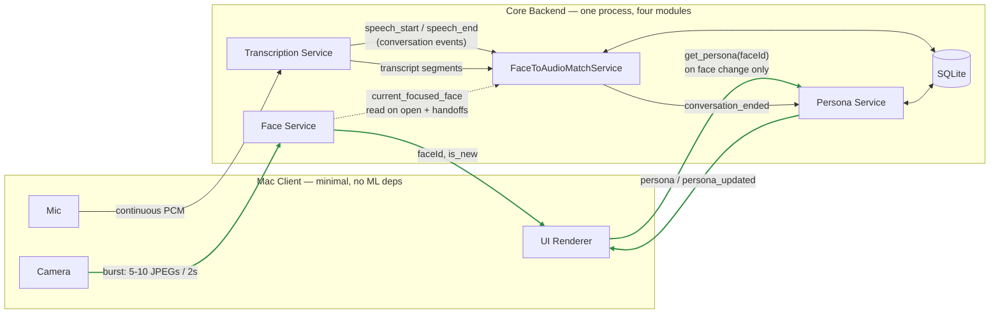
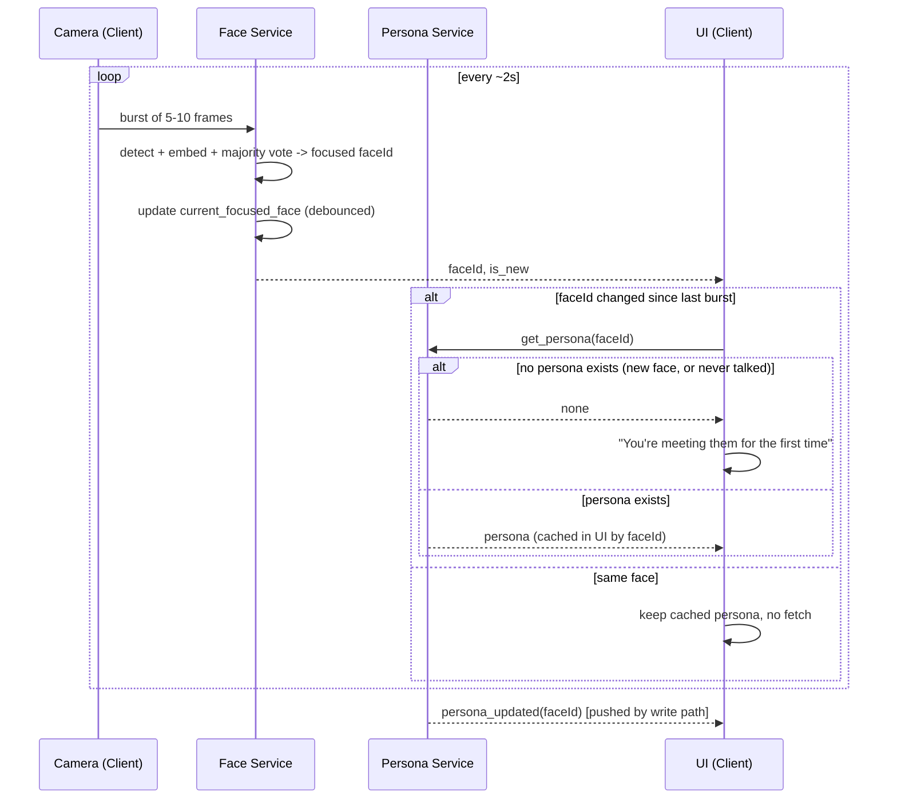
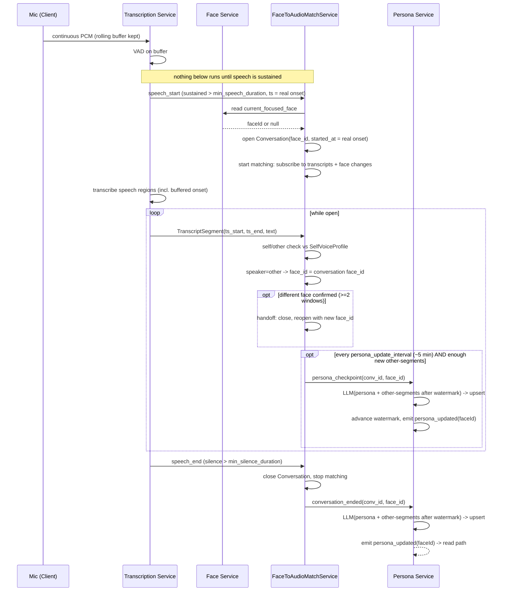
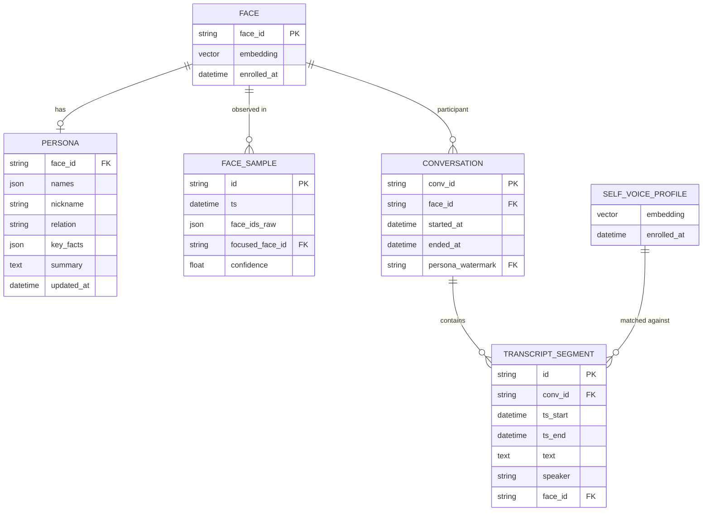
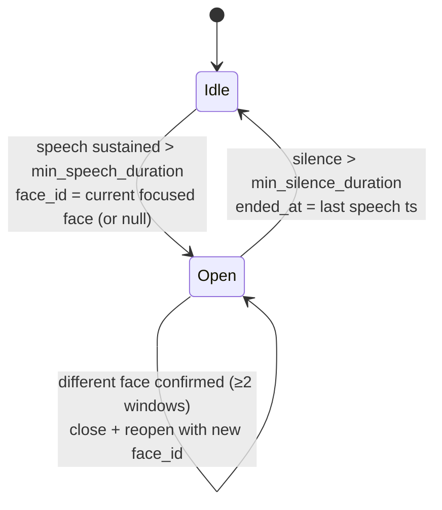

# Recall-AI — Design Doc

**Status:** hackathon prototype, not production. Goal is a working, demoable system —
simplicity and visible demo moments beat robustness or scale. See
[RESEARCH.md](RESEARCH.md) for prior-art justification and [TASKS.md](TASKS.md) for the
granular build checklist; this doc is the system design those two feed into, built around
the sketch below (frame sampling → face service → match service → persona service).

---

## 1. Overview

From a live AV stream on the Mac, split video and audio. Video is sampled in bursts and
sent to a face-recognition step that returns a `faceId` fast enough to update the UI live.
Audio is transcribed continuously and independently. A matching step joins the two by
timestamp, splits "what I said" from "what they said," and groups transcript by
conversation. When a conversation ends, an LLM turns the accumulated transcript into an
updated **Persona** for that face, which the UI displays next time that face is recognized.

Maps to GitHub issues [#1–#11](https://github.com/drraghavendra/Recall-AI/issues); this
pass covers the perception/persona core (#7, #8, #9, #10, #11) — recall/reminders/alerts
(#1–#4) are pushed to a later milestone (§9).

---

## 2. Entities

### Face
The biometric enrollment record — kept separate from `Persona` deliberately, so matching
logic never touches the human-readable profile.
- `face_id` (PK)
- `embedding` (vector)
- `enrolled_at`
- `thumbnail` (optional, for UI)

### Persona
- `face_id` (FK → Face)
- `names`: known names/aliases, possibly empty
- `nickname`
- `relation`: LLM-inferred label (friend / colleague / family / stranger / …)
- `key_facts`: short accumulated, deduped bullet facts
- `summary`: the rolling free-text paragraph (the main generated profile)
- `first_seen_at`, `last_seen_at`, `conversation_count`
- `updated_at`

### FaceSample *(your "Frame" entity, renamed for clarity — see §8 open question)*
One burst-window observation, not a single raw frame.
- `id`, `ts` (window start)
- `face_ids_raw`: every distinct face seen across the burst
- `focused_face_id`: the window's winning face (majority vote across the burst, largest-bbox tiebreak)
- `confidence`: fraction of burst frames that agreed on `focused_face_id` — a free
  byproduct of bursting instead of single-sampling

### Conversation *(added — see §8, this was implicit in your sketch but needs a home)*
- `conv_id`, `face_id` (nullable → self-only), `started_at`, `ended_at` (nullable while open)
- `persona_watermark`: last `TranscriptSegment.id` already fed to the persona LLM — so
  incremental mid-conversation updates and the final on-close update never reprocess the
  same segments (§7)
- Lifecycle is VAD-triggered (speech decides *when*), Face-Service-labeled (face decides
  *who*) — full detail in §7.

### TranscriptSegment
- `id`, `conv_id` (FK), `ts_start`, `ts_end`, `text`
- `speaker`: `"self"` | `"other"`
- `face_id`: set only when `speaker="other"` and a conversation was open

### SelfVoiceProfile
- `embedding` (one row, enrolled once), `enrolled_at`

---

## 3. Services

### Core (one deployable process, four internal modules — see §8 on why not literal microservices)

The system runs **two independent pipelines**:

- **Read path — always on.** Face → `faceId` → persona fetch → UI. Not gated by speech or
  conversations: a silent person in frame still gets their persona shown.
- **Write path — VAD-triggered.** A conversation event starts face↔transcript matching;
  conversation close triggers persona generation/update/data addition. Nothing in this
  path runs while nobody is talking.

| Module | Pipeline | Responsibility |
|---|---|---|
| **Face Service** | Read (+ feeds Write) | Detect + embed + match faces in each burst; majority-vote the focused face; instant `faceId`/`is_new` reply; maintains the live debounced `current_focused_face` that the Match module reads |
| **Persona Service — read** | Read | `get_persona(faceId)` for the UI; pushes `persona_updated` when the write side changes one |
| **Transcription Service** | Write | Runs VAD continuously over a rolling audio buffer; emits `speech_start`/`speech_end`; transcribes only speech regions |
| **FaceToAudioMatchService** | Write | **Idle until a conversation event.** On open: reads `current_focused_face` (*who*), back-dates `started_at` to the real speech start, then subscribes to face updates (handoffs) and transcript segments; runs self/other check; attaches `face_id`. On close: finalizes segments, emits `conversation_ended` — see §7 |
| **Persona Service — write** | Write | Every `persona_update_interval` (~5 min) while a conversation is open, and once more on `conversation_ended`: gather `speaker="other"` segments after the conversation's `persona_watermark`, LLM(existing persona + new transcript) → updated Persona, advance the watermark, push `persona_updated`. Creates the persona if none exists yet |

### Dependencies
- Face detect/embed: `DeepFace` or `InsightFace`
- VAD: `Silero VAD`
- Transcription: `whisper.cpp` (Core ML) / `faster-whisper` / cloud STT API
- Self/other voice check: `Resemblyzer`
- Persona generation: LLM API (Claude/GPT)
- Storage: `SQLite`
- Transport: WebSocket, client ↔ Core

---

## 4. Architecture

Green = always-on read path. Everything else = VAD-triggered write path. The dotted
edge is the only place the two touch: the Match module *reads* the Face Service's
current state when a conversation opens; it never sits in the read path.

## 5. Data flow

### 5a. Read path — always on, every burst

### 5b. Write path — triggered by VAD conversation events

## 6. Data model

---

## 7. Conversation lifecycle — VAD decides *when*, Face decides *who*

A conversation is a **speech event**. A recognized face sitting silently in frame is
co-presence, not a conversation. So the two signals get separate jobs:

| Signal | Owned by | Decides |
|---|---|---|
| VAD speech activity | Transcription Service → MatchService | **When** a conversation opens and closes |
| Debounced `focused_face_id` | Face Service → MatchService | **Who** it's with (the label), and handoffs |

(This corrects the earlier framing in RESEARCH.md §C, where VAD was only an efficiency
filter and face presence drove the boundary — that version would open "conversations"
with anyone who merely stood in frame.)

### Rules

**Open.** When speech has been sustained for `min_speech_duration` (~1–1.5s), open a
Conversation. Its `face_id` is whatever the Face Service's `current_focused_face` is at
that moment; `null` means a self session (talking to yourself, or to someone out of
frame). `started_at` is **back-dated to the real speech onset**, and the Transcription
Service keeps a rolling audio buffer (~3s) so that first 1–1.5s is still transcribed —
otherwise every conversation would lose its opening sentence. Opening is also what
starts face↔transcript matching; the Match module does nothing while no conversation is
open. (The persona *read* path is unaffected by any of this — see §3.)

**Stay open.** Pauses shorter than `min_silence_duration` (~5–8s) don't close it. A face
briefly leaving frame doesn't close or relabel it either — you don't forget who you're
talking to because they turned their head.

**Handoff.** If a *different* face becomes the confirmed focused face while a
conversation is open — confirmed across ≥2 consecutive FaceSample windows, since one bad
burst shouldn't relabel anything — close the current conversation at that timestamp and
open a new one with the new `face_id`. Speech doesn't need to pause for this.

**Close.** When silence exceeds `min_silence_duration`. `ended_at` is set to the last
detected speech timestamp, not the end of the grace window, so stored durations reflect
actual talking.

### State machine

### Separating conversation from noise

| Noise source | Rejected by |
|---|---|
| Ambient non-speech (traffic, music, typing, fans) | VAD itself — speech-vs-non-speech model, never flips speech-active |
| One-off sounds (cough, a single word, door slam) | `min_speech_duration` — too short to open a conversation |
| Silent face presence (someone nearby, not talking) | Open is gated on speech, not face — no speech, no conversation |
| Normal pauses mid-conversation | `min_silence_duration` grace keeps it open |
| Speech from a TV / video / phone speaker | **Partially.** VAD will fire on it. If no face is focused, it lands in a self session as `speaker="other"` with `face_id=null` (unattributed) — it won't pollute anyone's persona, but it will appear in the transcript |
| Someone else's conversation nearby, not involving you | **Not solved.** One mono mic has no direction or source separation. Mitigation: `other` segments only get a `face_id` when a conversation with that face is open; otherwise `face_id=null` (unattributed), never guessed |

The last two are stated limitations, not bugs. Directional audio (beamforming mic arrays,
as on Limitless/Meta glasses) is the real fix and is out of hackathon scope.

### Transcript attribution after this change

| `speaker` | Open conversation? | Stored as | Feeds |
|---|---|---|---|
| `self` | any | `face_id=null` | Self transcript; recall features (#2, #3) |
| `other` | yes, with face X | `face_id=X` | Persona X |
| `other` | yes, self session (`face_id=null`) | `face_id=null` | Nothing — unattributed |
| `other` | no (shouldn't happen — speech opens one) | — | — |

### Persona freshness during long conversations

Short conversations update the persona once, on close. Long ones shouldn't make you wait
until the end:

- **Incremental update** every `persona_update_interval` (~5 min) while a conversation is
  open — skipped if fewer than `persona_min_new_segments` new `other` segments arrived
  since the last run (no empty LLM calls during a long quiet stretch).
- **Final update** on close, covering whatever arrived after the last checkpoint.
- **Watermark** (`Conversation.persona_watermark`) ensures each segment reaches the LLM
  exactly once across checkpoints + close — otherwise a 15-minute conversation would feed
  minute 0–5 three times and overweight early facts.

How the UI learns about it — push primary, poll as safety net:

| Mechanism | Latency | Covers |
|---|---|---|
| `persona_updated` push over the existing WebSocket | seconds after the LLM returns | Normal case |
| Cache TTL — UI refetches the on-screen persona every 3–4 min | up to 3–4 min | Missed pushes (dropped socket, reconnect) |

Worst case with both: one update interval + LLM latency. Poll alone would add up to
another 3–4 min on top.

### Tunables

All of these live in one config block and should be tuned on the actual demo room, not
trusted from defaults: `min_speech_duration`, `min_silence_duration`, VAD speech
probability threshold (Silero default 0.5 — raise it in a noisy venue), the
handoff confirmation window count, `persona_update_interval` (~5 min; drop to ~1 min
for the demo so judges see it happen), `persona_min_new_segments`, and the UI cache TTL
(3–4 min). Silero's streaming helper handles speech/silence
padding natively; the `min_speech_duration` gate for *opening a conversation* is a thin
wrapper in MatchService around its speech-start event.

---

## 8. Design review — drawbacks & open questions in the original sketch

1. **Service-per-concern was modeled as literal microservices — recommend collapsing to one process.**
   Four named services (Face, Transcription, Match, Persona) as separate network services
   means N processes to keep alive during a live demo, N network hops of added latency,
   and distributed-systems failure modes (partial failures, retries, out-of-order delivery)
   that buy nothing at hackathon scale. §3/§4 above keep the same four-way split as clean
   internal modules in **one** Core process — same diagram, same eventual seam if you ever
   want to split them for real, zero deployment cost now.

2. **The sketch had no explicit conversation boundary.** `FaceToAudioMatchService` "merges"
   data, but nothing defined when a conversation starts/ends — which is exactly the trigger
   needed to know when to finalize a transcript batch and fire persona regeneration. Added
   the `Conversation` entity (§2), opened/closed by VAD speech activity and labeled by
   the focused face (§7), so the merge step has a real boundary instead of running
   continuously against an undefined window — and silent co-presence doesn't count as a
   conversation.

3. **No self-voice enrollment mechanism was named.** "We also store self conversation too"
   is right, but nothing said *how* self is told apart from the other person's voice. Added
   `SelfVoiceProfile` + a Resemblyzer same/different check inside
   `FaceToAudioMatchService` (§2, §3) — this was already designed in our prior pass and
   needs to carry forward, otherwise self-vs-other is hand-waved and personas risk
   absorbing your own words.

4. **"Active/talking face id" is ambiguous against an earlier decision.** We already decided
   (largest/most-centered face, not true lip-sync talking detection) for hackathon scope.
   I renamed the field to `focused_face_id` to match that decision. Worth noting: the
   5–10-frame burst this design introduces *does* make a cheap talking-face upgrade
   possible later (compare mouth-region motion energy across the burst, no ML needed) if
   there's time left — but it's not required and shouldn't be assumed in scope.

5. **Burst sampling (5–10 frames/2s) is ~2.5–5× more face-service calls than our earlier
   "1 sample per 1–2s" plan — call this out as a conscious tradeoff, not an oversight.**
   The upside is real: a majority vote *within* one window replaces the multi-window
   debounce timer from the previous design, so conversation-start detection becomes
   faster and gets a free confidence score, at the cost of more face-match compute. Since
   this all runs service-side (§3), it doesn't touch the Mac client's "minimal" budget —
   only bandwidth goes up slightly, which is a non-issue on localhost/LAN for a demo.

6. **The persona lags the live conversation by up to one update interval.** New facts
   reach the panel at the next checkpoint (~5 min) or on close, whichever comes first —
   e.g. Alice mentions she works at Google → it appears at the next checkpoint or a few
   seconds after you both stop talking, not while she's saying it. Right tradeoff (the
   live view never waits on an LLM); for the demo, drop `persona_update_interval` to ~1
   min and narrate it.

7. **First meetings key off "no persona", not `is_new`.** `is_new` is only true on the
   very first burst — two seconds later the face is enrolled but still has no persona. So
   the UI rule is: no persona → "You're meeting them for the first time," until the first
   conversation ends and `persona_updated` swaps in the real one. Side effect: someone
   seen before but never talked to also gets the first-time message. Fine for the demo;
   optional refinement is "You've seen them before (`Face.enrolled_at`) but haven't
   talked."

8. **Recall/reminders/alerts (#1–#4) aren't in this design pass.** Reasonable scoping call,
   not a flaw — just making it explicit rather than silently dropped. See §9, Milestone 5.

---

## 9. Milestones

Grouped from the detailed checklist in [TASKS.md](TASKS.md); stage numbers refer there.

| Milestone | Scope | TASKS.md stages |
|---|---|---|
| **M0 — Skeleton** | Client/service WebSocket boundary, SQLite schema, self-voice enrollment | Stage 0 |
| **M1 — Face perception + read path** | Burst sampling, Face Service, focused-face majority vote, enroll/match; always-on persona fetch + UI cache (hand-seeded personas until M4 exists) | Stage 1, 5 |
| **M2 — Conversation lifecycle** | Mic streaming + VAD; VAD-driven open/close, face-labeled, handoffs (§7) | Stage 2 |
| **M3 — Transcription** | Transcribe VAD speech regions + self/other split via Resemblyzer | Stage 3 |
| **M4 — Persona write path** | Persona generation on `conversation_ended`, rolling LLM summary, `persona_updated` push into the read path | Stage 4 |
| **M5 — Recall & alerts** *(stretch, if time remains)* | Reminders, item-location recall, task recall, alerts | Stage 6, 7 |
| **M6 — Polish** | End-to-end dry run, client/service failure handling, known-limitations writeup | Stage 8 |

Market research (issue #6 / TASKS.md Stage 9) runs in parallel throughout, doesn't block
any milestone above.

Demo-critical path if time runs short: **M0 → M1 → M2 → M3 → M4** is the whole "meet
someone, talk, see their persona next time" story — that alone is a complete demo. M5/M6
are additive.
